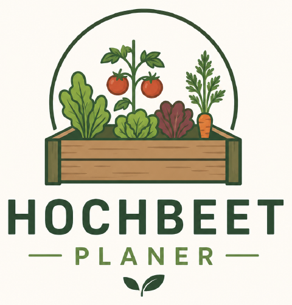

# Hochbeet-Planer

Ein Hochbeet maßstabsgetreu planen, gute Nachbarn finden und die Pflege
automatisch im Griff behalten — auf dem Handy, auch ohne Empfang im Garten.



## Was die App kann

**Beet planen.** Die Beetfläche wird in echten Zentimetern gezeichnet. Jede
Pflanze belegt auf dem Bildschirm genau die Fläche, die sie im Beet
beansprucht — nichts wird für die Bedienbarkeit größer gezeichnet, als es ist,
also sieht man sofort, ob noch etwas dazwischenpasst. Eng gesäte Kulturen wie
Karotten erscheinen als dichtes Feld kleiner Punkte; die Legende unter dem Beet
sagt, was da wächst. Auf dem Handy: antippen zum Setzen, antippen zum Auswählen,
ziehen zum Verschieben, mit zwei Fingern zoomen.

**Mischkultur prüfen.** Gute und schlechte Nachbarn werden live markiert und
mit Begründung erklärt (Gertrud Franck, Bioland u. a.). Konflikte lassen sich
mit einem Tipp automatisch auflösen.

**Zeitachse statt Saisons.** Jede Pflanzung hat ein Datum von–bis. Oben im
Beet wählt man Jahr und Monat; gezeigt wird, was in der Monatsmitte im Beet
steht. Vor-, Haupt- und Nachkultur teilen sich so denselben Platz — Spinat bis
Mai, dann Paradeiser, dann Vogerlsalat. Neue Pflanzungen bekommen ihre Daten
aus den Pflanzendaten und passen sich automatisch zwischen Vor- und Nachkultur
ein; die Zeitachse (Gantt) zeigt das ganze Jahr und erlaubt, Daten zu ändern.
Später geplante Kulturen erscheinen im Beet als gestrichelter Umriss.

**Befüllungsjahr.** Jedes Beet kennt das Jahr, in dem es befüllt (oder zuletzt
aufgefüllt) wurde. 1. und 2. Jahr: Starkzehrer, 3. Jahr: Mittel- und
Schwachzehrer, danach Auffüllen. Analyse, Pflanzenliste und Plan-Generator
richten sich danach, und im März des Auffülljahres kommt eine Aufgabe.

**Fruchtfolge über Jahre.** Der Jahresplan zeigt die letzten vier Jahre eines
Beets, warnt wenn eine Familie vor Ablauf ihrer Anbaupause zurückkommt (z. B.
Kohl 4 Jahre, Paradeiser sind selbstverträglich) und wenn innerhalb eines
Jahres ein naher Verwandter auf demselben Platz folgt (Spinat → Mangold).

**Aufgaben bekommen.** Aus den datierten Pflanzungen entstehen Vorzieh-
(6 Wochen vor dem Auspflanzen), Pflanz-, Ernte-, Pflege- und Gießtermine —
inklusive Eisheiligen-Warnung für frostempfindliche Kulturen. Gießaufgaben
entfallen, wenn es am Tag und Vortag zusammen mindestens 5 mm geregnet hat,
und an Hitzetagen (ab 30 °C) kommt eine dazu.

**Plan generieren.** Der Generator baut eine echte Reihenmischkultur: hohe
Pflanzen nach hinten, keine verfeindeten Nachbarreihen, Reihenabstände nach
den Pflanzabständen. Er packt so viel von deiner Auswahl ins Beet, wie die
Tiefe hergibt — und sagt zu jeder Pflanze, die es nicht hineingeschafft hat,
warum (falsche Saison, zu tief für das Beet, kein Platz mehr). Aus der
Beetansicht heraus startbar, mit dem Beet und der Saison als Vorgabe.

**Ernte protokollieren.** Geplanter gegen tatsächlichen Ertrag je Beet.

**Wetter.** Frost-, Hitze- und Gießhinweise für die konkret gepflanzten Arten,
von Open-Meteo (kein API-Schlüssel nötig). Die letzten drei Wochen Niederschlag
werden lokal gespeichert, damit Gießaufgaben auch offline stimmen.

## Bedienung auf dem Handy

- **Tippen auf die Erde** setzt die gewählte Pflanze. Passt sie nicht, sagt die
  App warum, statt einfach nichts zu tun.
- **Tippen auf eine Pflanze** wählt sie aus und öffnet die Aktionsleiste
  (Anzahl −/+, Info, Entfernen). Ein Fehltipp löscht nichts mehr.
- **Ziehen** verschiebt, **zwei Finger** zoomen, **Doppeltipp** zoomt auf die
  Stelle.
- Jede löschende Aktion lässt sich über die Meldung sofort **rückgängig**
  machen.
- Alle Detailbereiche (Analyse, Pflege, Ernte, Notizen, Einstellungen) sind als
  Bottom-Sheets erreichbar — auf dem Handy gibt es dieselben Funktionen wie am
  Rechner.
- Dunkelmodus, Safe-Area-Unterstützung für Notch und Home-Indicator,
  Touch-Ziele ab 44 px.

## Offline & Installation

Die App ist eine PWA: Sie lässt sich über *Einstellungen → Zum Homescreen
hinzufügen* installieren, startet ohne Browserleiste und funktioniert offline.
Alle Beete liegen lokal im Browser; mit Konto werden sie zusätzlich mit
Firestore synchronisiert.

## Entwicklung

```bash
npm install
npm run dev       # Entwicklungsserver
npm run build     # Produktions-Build nach dist/
npm run preview   # Build lokal ausliefern (Service Worker aktiv)
npm test          # Tests (Zeitachse, Aufgaben, Fruchtfolge, Wetter, Sync, Generator)
npm run lint      # ESLint
npm run icons     # Logo/Icons aus assets/logo-source.png neu erzeugen
```

Konfiguration über `.env` (siehe `.env.example`). Ohne Firebase-Schlüssel läuft
die App vollständig lokal — das Firebase-SDK wird dann gar nicht erst geladen.

Mit Firebase: Die Regeln in `firestore.rules` mit `firebase deploy --only
firestore:rules` einspielen. Jedes Konto sieht nur `users/{uid}/beds`. Beete
werden immer vollständig mit Revisionsnummer geschrieben; beim Abmelden
verlassen die Beete des Kontos das Gerät.

## Aufbau

```
src/
  data/plants.js         Pflanzendaten + Mischkultur-Matrix
  data/plantDetails.js   Aussaat-/Erntemonate, Zehrerklasse, Wurzeltiefe, Erntedauer
  lib/beds.js            Beet-Store (localStorage + Firestore-Spiegel)
  lib/timeline.js        Datierte Pflanzungen, Vor-/Nachkultur, Migration
  lib/weather.js         Open-Meteo-Wetter mit lokalem Verlauf
  lib/tasks.js           Aufgaben-Store
  lib/harvests.js        Ernteprotokoll-Store
  utils/planGenerator.js Reihenmischkultur-Generator (siehe tests/)
  utils/taskEngine.js    Aufgaben aus Bepflanzung, Beetalter und Wetter
  utils/rotationAdvice.js Fruchtfolge über Jahre und Folgekulturen
  utils/bedAge.js        Befüllungsjahr → Stark-/Mittel-/Schwachzehrer
  utils/weatherAdvice.js Wetterhinweise
  hooks/useBed.js        Bearbeitung eines Beets im gewählten Monat (Setzen, Verschieben, Daten, Undo)
  components/BedCanvas   Zeichenfläche mit Zoom, Auswahl und Kollisionsprüfung
  pages/                 Bildschirme
```

## Datenquellen

Mischkultur- und Anbaudaten nach Gertrud Franck („Mischkulturen im
Gemüsegarten"), Bioland-Anbaurichtlinien, DGG und weiteren deutschsprachigen
gartenbaulichen Veröffentlichungen. Angaben sind Richtwerte für Mitteleuropa
(Zone 6–8).
